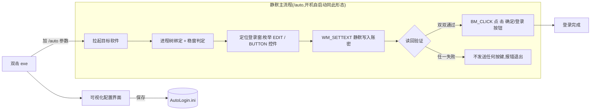

<div align="center">

# AutoLogin —— 上位机开机自动登录工具

**拉起上位机软件 → 自动填入账号密码 → 点"确定"登录,全程无人值守**


单文件 exe(零依赖、免安装、拷走即跑),双击打开可视化配置界面;
开机由启动项静默执行,精确控件模式下**账密验证不过绝不提交**。

</div>

---

## 快速开始

```powershell
# 1) 获取仓库(或直接下载 AutoLogin.exe)
git clone https://github.com/lq700212/AutoLogin.git
cd AutoLogin

# 2) 运行(双击 AutoLogin.exe 等价):打开可视化配置界面
Start-Process .\AutoLogin.exe

# 3) 静默登录形态(即开机自启动所用的形态)
Start-Process .\AutoLogin.exe -ArgumentList "/auto"     # 同样支持 -auto /run /silent
```

部署到工控机见 [部署步骤](#部署到工控机);开机自启动在配置界面**一键开关**,无需手写命令。

## 界面速览


*出厂默认态:四张卡片覆盖全部配置项,底部三个动作按钮;右上角"×"退出不影响已保存配置。*

所有配置落盘 `AutoLogin.ini`,界面"保存"与手工编辑完全兼容。

## 特性

- **精确控件模式**:枚举登录框子控件后点名操作,`WM_SETTEXT` 静默写入账密并读回验证,
  提交只点"确定/OK/登录"按钮,**绝不触碰"取消",验证不过绝不发送任何按键**;
- **可视化配置**:WPF 深色界面(uiverse 风格),ini 全部配置项一屏可改,"保存并立即运行一次"即刻后台试跑;
- **一键开机自启动**:界面开关即建/删启动项快捷方式,目标自动带 `/auto` 参数与程序图标;
- **单文件零依赖**:csc 直编 winexe,WPF 用 Windows 自带运行库,图标编译进 exe,覆盖旧 exe 即升级;
- **现场友好**:输入框序号认错改一个 ini 数字即可,不用重新编译;日志超 512KB 自动清理,不会无限膨胀。

## 工作流程



- 双形态共用同一份配置:双击 = 配置编辑,`/auto` = 静默执行;
- 所有 Win32 交互(枚举/写入/读回/点击)全程有日志,现场问题看 `AutoLogin.log` 定位到步。

## 目录树

```text
AutoLogin/
├── AutoLogin.exe        # 主程序:双击=配置界面,/auto=开机静默登录(单文件)
├── AutoLogin.cs         # 自动登录主流程 + 自启动部署源码
├── AutoLoginGui.cs      # 可视化配置界面源码(WPF 纯代码,无 XAML)
├── assets/
│   ├── app.ico          # 程序图标(9 档 16~256px,经 /win32icon 编译进 exe)
│   └── app.png          # 图标设计源文件(800×800)
├── docs/
│   └── images/          # README 配图
└── README.md            # 本文档
```

> `AutoLogin.ini`(现场账密)与 `AutoLogin.log`(运行日志)只在运行机生成,**不入 git 库**。

## 配置

配置来自 exe 同目录的 `AutoLogin.ini`;**首次运行 exe 自动生成默认模板**,所有键可省,
必填仅 `ExePath`:

| 键 | 说明 | 默认 |
|------|------|------|
| `ExePath` | 目标软件 exe / .lnk / 工程文件完整路径(必填,支持中文) | (空) |
| `UserName` | 登录账号(支持中文) | 操作员 |
| `Password` | 登录密码,界面以掩码回显 | (模板占位值,部署时改为现场密码) |
| `TitleKeyword` | 登录窗口标题关键词,留空=自动识别;多软件并发时建议填 | 空 |
| `WaitWindowSec` | 启动后最多等登录框多少秒 | 120 |
| `ReadyDelayMs` | 登录框出现后再等多少毫秒动手 | 3000 |
| `TypeDelayMs` | 键盘兜底模式每字符间隔毫秒 | 30 |
| `MsgBoxOnFail` | 失败弹窗(1/0) | 1 |
| `RetryOnStillOpen` | 提交后登录框未关时重试一轮(默认关) | 0 |
| `UserEditOrd` | 用户名=第 N 个非密码输入框(认错框时改 2) | 1 |

## 部署到工控机

1. 拷贝 `AutoLogin.exe` 覆盖旧的(ini 不用动,旧配置兼容);
2. 核对 ini 的 `ExePath` 与现场软件路径一致,账密核对;
3. 双击 exe 打开配置界面,点**保存并立即运行一次**试跑,确认软件拉起、账密写入并被"确定"提交;
4. 日志出现 `精确控件模式:...` 与两行 `读回验证 通过` 即机制就位;
5. 在"行为"卡片打开**"开机自动运行"**开关——自动创建启动项快捷方式
   (`shell:startup\AutoLogin.lnk`,目标已含 `/auto`,图标=本 exe);
6. 重启工控机,验证开机后软件自动登录进主界面。

## 精确控件模式(为什么它稳)

登录框初始焦点不一定在用户名输入框上(实测就有初始焦点在按钮上的登录框):
旧式"给窗口焦点→整串键盘输入→回车"会字符被吞、焦点漂移、回车点中"取消"。
本工具从机制上根除:

1. **枚举控件**:`EDIT` 类输入框按 Z 序编号,`ES_PASSWORD` 样式为密码框,
   其余为用户名框;输入框属于下拉框时自动改为对下拉框本体写文本;
   按钮按标题匹配 **确定/OK/登录/登陆**(去空格匹配),取消类按钮永不触碰;
2. **静默写入 + 读回验证**:`WM_SETTEXT` 写入(不动键盘、不依赖焦点),读回对照——
   用户名必须完全一致,密码按读回长度比对;写不进才降级为"焦点钉住控件→键盘输入→再验证";
3. **提交点名**:验证通过后向"确定/登录"按钮发 `BM_CLICK`,没有该类按钮才回车兜底;
4. **验证不过绝不提交**:任一验证失败,不发送任何按键/点击,报错退出。

另有进程树绑定(只认目标软件进程树,同机其它软件弹窗不误伤)、稳窗判定(防 splash 抢跑)、
焦点确认重试、防双开互斥等守护机制,详见源码注释。

## 常见问题排查(看 `AutoLogin.log`)

| 日志现象 | 含义与处理 |
|----------|------------|
| `精确控件模式:...确定按钮 N 个` + `读回验证 通过` | 正常:账密已写入,提交走"确定"按钮 |
| `用户名框属于下拉框(ComboBox)...` | 正常:下拉框场景自动适配 |
| `EDIT#2 当前文本=~xxx~` | 用户名不在第一个框,ini `UserEditOrd=2` 再跑 |
| `账密读回验证未通过 => 不发送...中止` | 守门生效,未提交任何键;按 EDIT# 行核对框位/内容 |
| `精确模式放弃:EDIT 控件数=0` | 登录框为自绘控件,自动走键盘兜底;仍失败把日志发给维护者 |
| `失败:N 秒内没有发现像登录框的窗口` | 软件没弹登录框,或 UAC 卡住(用任务计划程序以最高权限运行) |
| `另一个实例正在输入账密` | 防双开保护,正常现象 |

## 维护者:编译

在工程根目录一条 csc 命令直编:

```powershell
C:\Windows\Microsoft.NET\Framework64\v4.0.30319\csc.exe /nologo /target:winexe /platform:anycpu /codepage:65001
  /win32icon:"assets\app.ico"
  /lib:"C:\Program Files (x86)\Reference Assemblies\Microsoft\Framework\.NETFramework\v4.8"
  /r:PresentationFramework.dll /r:PresentationCore.dll /r:WindowsBase.dll /r:System.Xaml.dll
  /r:System.dll /r:System.Core.dll
  /out:AutoLogin.exe AutoLogin.cs AutoLoginGui.cs
```

- WPF 界面用纯 C# 构建(不用 XAML),无需 msbuild/XAML 编译管道;
- 主流程只依赖 Win32 API 与 mscorlib,与界面代码解耦;代码约束 .NET Framework 4.8 / C# 5 语法;
- 覆盖编译前若 exe 在运行,先结束进程;图标相关说明见上文目录树与 `assets\` 注释。
